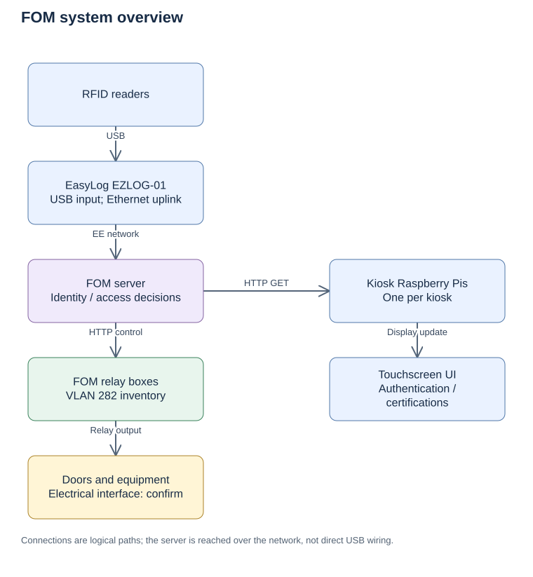
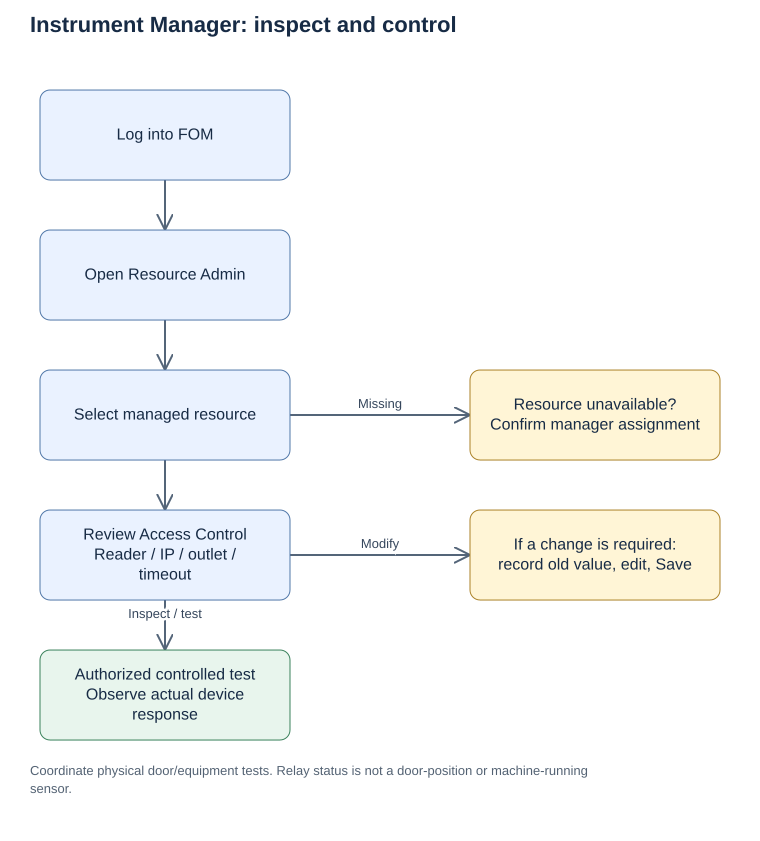
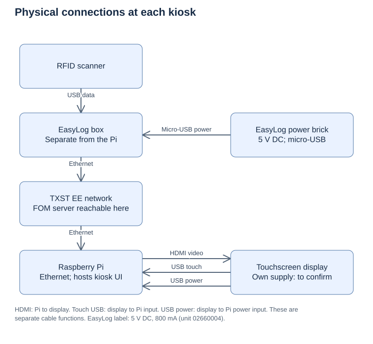
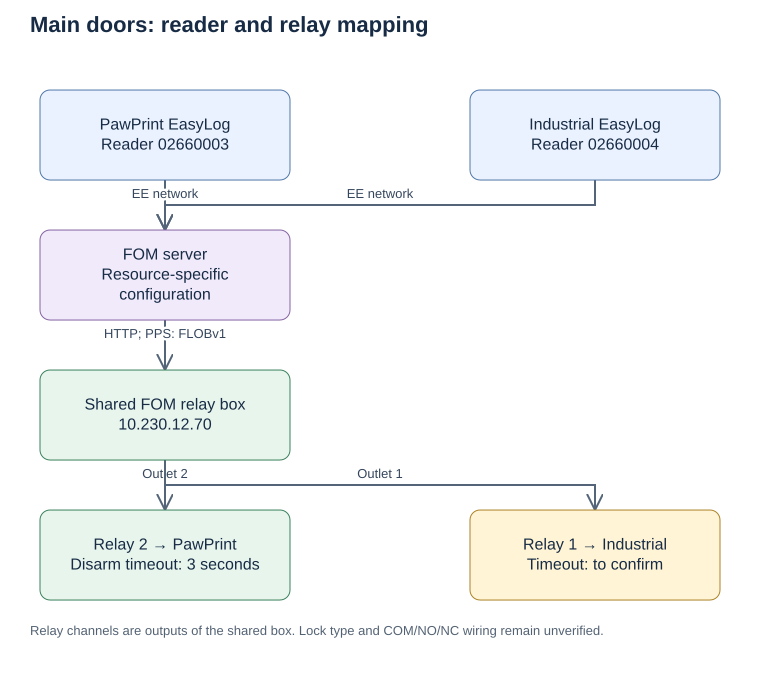
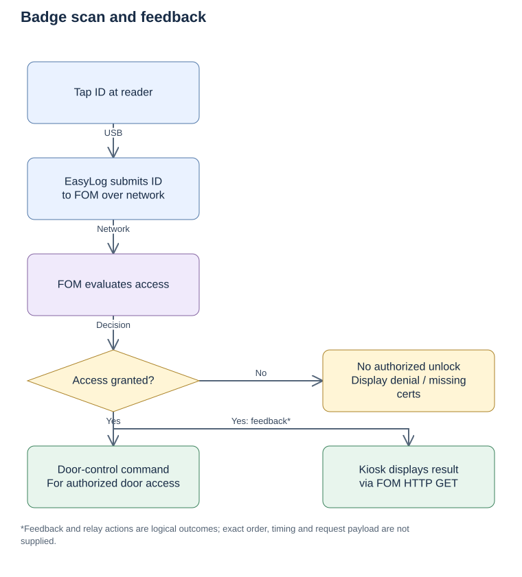
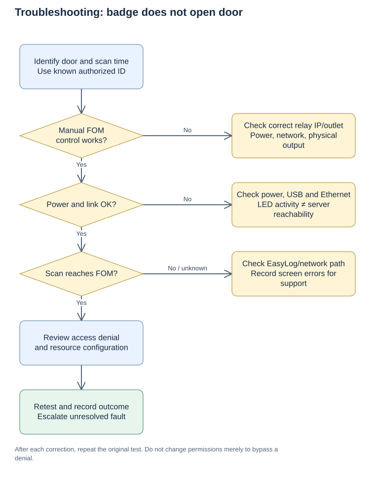
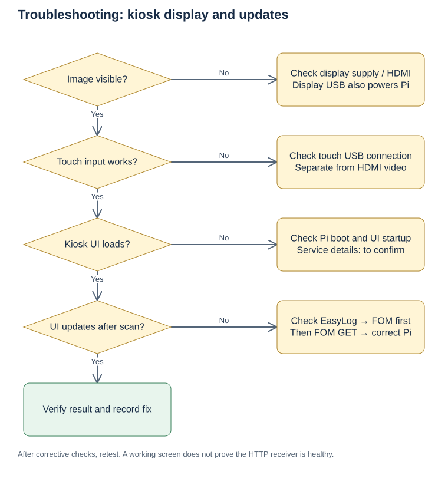

# FOM Makerspace — Student Technician Manual

**Configuration reference • 20 November 2026 • v0.1**

This manual covers the makerspace FOM server, EasyLog ID readers, two Raspberry Pi kiosks, door controllers, and the equipment relay inventory. It is intended for student technicians. All systems were reported working by the operator on 20 November 2026; this is not a live status dashboard or an independent commissioning test.

**Coverage:** confirmed connections and configuration are documented below. Terminal-level electrical wiring, several device addresses, and software recovery details remain to be confirmed. Do not treat a logical diagram as a terminal wiring schematic.

## Contents

- [System overview](#system-overview)
- [Access and manager controls](#access-and-manager-controls)
- [Network and device inventory](#network-and-device-inventory)
- [EasyLog and kiosk wiring](#easylog-and-kiosk-wiring)
- [Door configuration](#door-configuration)
- [Normal badge operation](#normal-badge-operation)
- [Troubleshooting](#troubleshooting)
- [Maintenance and escalation](#maintenance-and-escalation)
- [Open items](#open-items)
- [Diagram editing and GitHub](#diagram-editing-and-github)

## System overview

[FOM web portal](https://fom.engineering.txstate.edu/fom/)

An RFID reader connects by USB to an EasyLog EZLOG-01 box. The EasyLog communicates with FOM through Ethernet on the TXST EE network. FOM controls relay boxes through HTTP. Relay outputs operate doors or equipment; the equipment's exact electrical interface is not yet recorded.

Each main-door kiosk has its own Raspberry Pi, distinct from the EasyLog box. FOM sends HTTP GET requests to the Pi, whose server starts at boot and updates the login UI with authentication results or missing certifications. The Pi is a display/feedback component in the documented architecture, not the confirmed source of relay commands.



## Access and manager controls

Technicians require Instrument Manager access for each resource they inspect or modify.

1. Log into FOM.
2. Open **Resource Admin**.
3. Select a resource for which you are an **Instrument Manager**.
4. Find **Access Control**.
5. Check the reader ID, communication method, relay IP, and outlet against this manual.
6. Review **Relay Status**, the available manual control, and **Disarm timeout**.
7. Before changing settings, record the previous values and reason. Use the relevant **Save** control after an intentional change.
8. Coordinate any physical test with the responsible technician, observe the device, and verify the intended state afterward.

The supplied PawPrint page displayed **Relay Status: OFF / Turn on**. That was a snapshot, not a failure indication. A relay state is not proof of door position or machine operation. If the expected resource is absent, have its manager verify your assignment.



## Network and device inventory

| Setting | Recorded value |
|---|---|
| Relay VLAN | 282 |
| Subnet mask | 255.255.255.192 (/26) |
| Subnet (derived) | 10.230.12.64/26 |
| Gateway | 10.230.12.65 |
| EasyLog and kiosk connection | Ethernet on TXST EE network |
| Pi/EasyLog VLAN and IP assignments | Not individually confirmed |
| Server hosting, server IP and network ownership | Not supplied |

The following addresses are relay/network inventory entries, not automatically EasyLog or kiosk addresses. Blank uses mean unassigned in the supplied record, not verified free addresses. Do not assign one without network-owner confirmation.

| IP | Use | MAC | Physical port |
|---|---|---|---|
| 10.230.12.69 | Manual Mills | 70B3D50BC1D0 | EE1313-052 |
| 10.230.12.70 | PawPrint Studio, Industrial Area | 70B3D50BC1CF | EE1313-001 |
| 10.230.12.71 | Printers, CoreOne #1-6, markforged | 70B3D50BC1E6 | EE1313-015 |
| 10.230.12.72 | Printers, CoreOne #9-12, BYOF, MMU | 70B3D50BC1E7 | EE1313-019 |
| 10.230.12.73 | 1202 Side Rooms | 70B3D50BC1E5 | EE1313-070 |
| 10.230.12.74 | Prusa Mini #1-2 | 70B3D50BC189 | EE1313-023 |
| 10.230.12.75 | Prusa Mini #3-4 | 70B3D50BC188 | EE1313-021 |
| 10.230.12.76 | EasyLogon Error Handling | Not recorded | Not recorded |
| 10.230.12.77 | Printers, CoreOne #7-8, XLs | 70B3D50BC1E9 | EE1313-017 |
| 10.230.12.78 | Manual Lathes | 70B3D50BC1CD | EE1313-040 |
| 10.230.12.79 | xtools, RobotZone_Relayboard1 | Not recorded | Not recorded |
| 10.230.12.80 | Unassigned in supplied inventory | Not recorded | Not recorded |
| 10.230.12.81 | Unassigned in supplied inventory | Not recorded | Not recorded |
| 10.230.12.82 | Unassigned in supplied inventory | Not recorded | Not recorded |
| 10.230.12.83 | Unassigned in supplied inventory | Not recorded | Not recorded |
| 10.230.12.84 | Unassigned in supplied inventory | Not recorded | Not recorded |

The original port discrepancy `EE1313-01` vs `EE1313-001` is resolved here in favor of the supplied device CSV (`EE1313-001`); confirm the physical label on site. `10.230.12.76` is recorded as **EasyLogon Error Handling**; it has not been confirmed as either kiosk Pi. All equipment-to-relay channel mappings beyond the door tables below remain unverified.

The sanitized machine-readable inventory is [data/device-inventory.csv](data/device-inventory.csv). Access keys and passwords are deliberately omitted.

## EasyLog and kiosk wiring

| Location | EasyLog unit ID | Model | MAC | Recorded port |
|---|---|---|---|---|
| PawPrint Studio | 02660003 | EZLOG-01 | 70:B3:D5:0B:C2:86 | MDF1313-053 |
| Industrial Area | 02660004 | EZLOG-01 | 70:B3:D5:0B:C2:87 | No label recorded |
| IGRM 1202D | 02660002 | EZLOG-01 | 70:B3:D5:0B:C2:85 | MDF-1312-151 |
| Location unknown | 02660001 | EZLOG-01 | 70:B3:D5:0B:C2:84 | Not recorded |
| Location unknown | 02660005 | EZLOG-01 | 70:B3:D5:0B:C2:88 | Not recorded |

PawPrint kiosk is in front of the front door; Industrial kiosk is beside the Industrial door. There is **one Pi per kiosk**, two Pis total for these kiosks.

| From | To | Connection / function |
|---|---|---|
| RFID scanner | EasyLog box | USB, scanned-ID input |
| EasyLog power brick | EasyLog box | Micro-USB power; pictured unit label: 5 V DC, 800 mA |
| EasyLog Ethernet port | EE network port | Network communication with FOM |
| Pi Ethernet port | EE network port | Receives FOM HTTP GET requests |
| Pi HDMI output | Touchscreen display | Video |
| Touchscreen touch USB | Pi USB data port | Touch input |
| Display USB power output | Pi power input | Pi power, confirmed by operator |
| Display external supply | Display power input | Supply type/rating not supplied |
| FOM relay output | Door/equipment circuit | Terminal wiring and load interface not supplied |

Power from the display and the touch USB connection serve different functions. Confirm actual ports before replacement. Turning off the display may also remove Pi power, depending on its USB power behavior; confirm this locally. Ethernet LEDs show link/activity, not application connectivity.



## Door configuration

| Resource | Reader ID | Relay IP | Outlet | Method | Disarm timeout |
|---|---|---|---|---|---|
| PawPrint Studio (IGRM 1201) | 02660003 | 10.230.12.70 | 2 | FLOBv1 | 3 seconds |
| Industrial Area | 02660004 | 10.230.12.70 | 1 | To confirm | To confirm |

PawPrint's resource status was **Active** in the supplied settings page. FOM describes a nonzero disarm timeout as automatically turning the relay off after the specified seconds whenever it is turned on. This documents relay timing; lock polarity, COM/NO/NC terminals, lock voltage and fail behavior have not been confirmed. Do not infer them from the words ON and OFF.

| Side-room door | Name | Controller | Relay |
|---|---|---|---|
| 1202A | Wood Shop | 10.230.12.73 | 1 |
| 1202D | Senior Design | 10.230.12.73 | 2 |
| 1202E | S.D.B / SAE | 10.230.12.73 | 3 |
| 1202F | Composites | 10.230.12.73 | 4 |
| 1202G | CIM/Robotics | 10.230.12.73 | 5 |

The labels “IGRM 1202D,” “Senior Design,” and “1202D Project Room” appear in different supplied records; verify the current resource name before modifying settings.



## Normal badge operation

1. A user presents an ID to the RFID reader.
2. The reader transfers ID data to the separate EasyLog box by USB.
3. EasyLog communicates with FOM over the EE network.
4. FOM evaluates the resource's access conditions.
5. For authorized door access, FOM commands the corresponding relay output. FOM also sends the kiosk Pi an HTTP GET request to update the UI.
6. The kiosk displays authentication feedback or missing certifications.
7. Where configured, disarm timeout turns the relay off automatically. PawPrint's configured value is 3 seconds.

The exact order of kiosk notification versus relay actuation is not verified. GET paths, payloads, HTTP listening port, service names and session/check-in semantics were not provided. The copied FOM settings page is not kiosk application source code. The flattened copy does not preserve selected states for every multi-select or checkbox, so prerequisite selections are not inferred from its option lists.



## Troubleshooting

Start by identifying the resource, device IP, reader ID, physical port, exact time and symptom. Determine whether one device or several devices are affected. Observe first; preserve evidence before restarting services. Coordinate door and equipment actuation. Do not bypass interlocks, bridge relay terminals, or rewire energized circuits; electrical work belongs with authorized personnel.

### Badge does not unlock the door



| Observation | Next check | Interpretation / action |
|---|---|---|
| Reader has no indication | EasyLog power brick, micro-USB lead, scanner USB connection | A beep/light alone does not prove ID delivery |
| Ethernet link absent | Cable seating, documented jack, approved known-good cable | Record port label; involve network staff if unresolved |
| Manual FOM control works, badge does not | EasyLog input, FOM receipt, access decision, reader-resource mapping | Working manual control narrows fault to badge/authorization/automatic action path |
| FOM reports missing certifications | User's required training and resource access | Follow the normal training/permission process; do not bypass it |
| Manual control fails too | Correct resource IP/outlet, controller power and network | Do not assume the RFID reader is responsible |
| Relay responds but lock/equipment does not | Correct output channel and downstream interface | Escalate electrical/lock inspection; do not improvise wiring |
| Wrong door responds | Stop tests and compare IP/outlet mapping | Escalate and correct only with authorized configuration review |
| Internal Server Error | Capture exact screen text, URL if shown, time and affected devices | Does not by itself prove whether failure is local or remote; contact FOM support |

### Kiosk blank, touch unresponsive, or result stale



Check display power, Pi power supplied from display USB, HDMI, and the separate touch USB cable. If the UI loads but never changes, first determine whether FOM received the EasyLog scan. Then check the callback destination for that kiosk and the Pi's HTTP receiver. A network link does not prove that the auto-started application is running. Service-specific commands are pending the actual deployment details; do not use invented service names.

### Read-only network checks

From an authorized workstation on the appropriate network, these optional checks help collect evidence. They do not issue relay-control commands.

```sh
# Main-door controller: ICMP may be blocked even when HTTP works.
ping -c 4 10.230.12.70
# Inspect local interface and routing information on Linux.
ip -br address
ip route
```

Do not copy the relay subnet onto a Pi or EasyLog unless its assigned network configuration is confirmed. If several controllers fail simultaneously, investigate shared network/server dependencies before changing individual resources. Do not use undocumented HTTP actuation URLs.

### Known incident

Around 6–7 November 2026, badge access failed while manual FOM-to-relay door control worked. HDMI diagnostics on an EasyLog showed an initial attempt to connect to FOMNetwork, followed by “Internal Server Error.” On 20 November the operator reported all systems working. Root cause and repair steps were not supplied; no restart, update, or firmware fix is claimed.

## Maintenance and escalation

Record any changed field, old/new values, resource, technician, time, and verification result. Keep approved configuration backups before replacing controllers or EasyLog units. Preserve reader IDs and resource mappings during replacements, and verify IP/MAC/port assignments with the network owner. After a change, verify the correct door/equipment responds and returns to its intended state, and that kiosk feedback matches the test.

An escalation record should contain resource name; time; reader unit ID; controller IP/outlet; physical jack; observed power/link indicators; whether manual FOM control works; whether FOM received the scan; exact error; changes tried; and final state. FOM vendor contact on the EZLOG label: info@fomnetworks.com, +1-224-225-9168. Local network and facilities contacts are to be added.

## Open items

- Each Pi IP/MAC/network port and VLAN; identify the device at 10.230.12.76.
- Each EasyLog IP and network assignment; location of units 02660001 and 02660005.
- Display power supply, Pi model, scanner model and relay-box model/rating.
- Terminal-level door wiring, lock type/voltage, COM/NO/NC, power supply and exit/safety interfaces.
- Whether equipment relays switch power outlets, contactors or enable inputs; individual equipment-to-outlet mappings.
- Industrial communication method/disarm timeout; side-room reader mapping and timing.
- Kiosk callback endpoints, payloads, app location, startup/service name, logs and approved recovery procedure.
- Server hosting/administration, local escalation contacts and prior incident resolution.

These gaps are intentionally visible so future technicians can distinguish established facts from details requiring on-site confirmation.

## Diagram editing and GitHub

Keep `README.md`, `flowcharts/`, and `data/` together at the repository root. The relative SVG image links above display the diagrams in the README without plugins. Each diagram also has an editable `.drawio` source. Open it in draw.io / diagrams.net; after editing, export SVG with the same basename into `flowcharts/` and commit both files. The supplied SVG previews are generated from the same node/edge definitions as the editable sources.

| Diagram | Editable source |
|---|---|
| FOM system overview | [01-system-overview.drawio](flowcharts/01-system-overview.drawio) |
| Physical connections at each kiosk | [02-kiosk-wiring.drawio](flowcharts/02-kiosk-wiring.drawio) |
| Main doors: reader and relay mapping | [03-door-mapping.drawio](flowcharts/03-door-mapping.drawio) |
| Badge scan and feedback | [04-badge-flow.drawio](flowcharts/04-badge-flow.drawio) |
| Instrument Manager: inspect and control | [05-manager-controls.drawio](flowcharts/05-manager-controls.drawio) |
| Troubleshooting: badge does not open door | [06-access-troubleshooting.drawio](flowcharts/06-access-troubleshooting.drawio) |
| Troubleshooting: kiosk display and updates | [07-kiosk-troubleshooting.drawio](flowcharts/07-kiosk-troubleshooting.drawio) |

## Sources and handling

Based on operator descriptions in this conversation, the supplied `FOM_Relays(Device Config).csv`, EZLOG label photograph, the earlier EasyLog/side-room tables, and the copied PawPrint FOM Resource Admin page. No live network verification was performed. Credentials, access keys, user lists and tokenized view-only links from the source material are not included. Review site-specific network information before publishing a public repository.
